# 300: El Paso de las Termópilas

**Estrategia táctica en pixel art con órdenes de voz.** Dirige a la falange griega en el paso de las Termópilas (480 a. C.) y resiste el avance del ejército de Jerjes con tu voz, con el teclado o con los botones.

### [▶ Jugar en línea](https://c4r127.github.io/termopilas-game/)

Funciona en el navegador, sin instalar nada, en ordenador, tableta y móvil. Para mandar con la voz, usa Chrome o Edge.

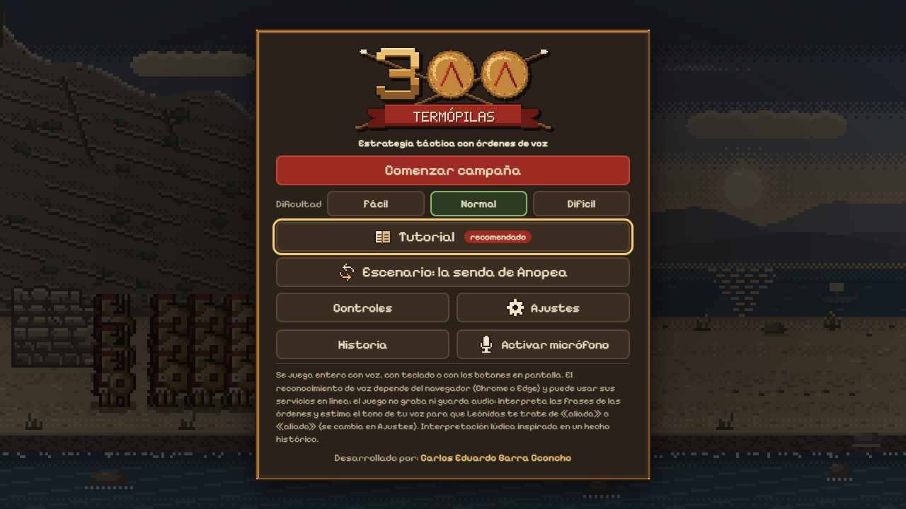

## El juego

Termópilas, 480 a. C. Un paso estrecho entre la montaña y el mar, y una línea de hoplitas que no puede ceder. Cada orden cuenta: levanta los **escudos** cuando caen las flechas, ataca con las **lanzas** cuando la infantería choca con la línea, **empuja** al enemigo hacia el acantilado y pide **relevo** antes de que la falange se agote. Leónidas te acompaña con partes, consejos y avisos durante toda la batalla.

Puedes jugar la **campaña** (cinco oleadas y un enfrentamiento final contra Jerjes I), el **escenario histórico de la senda de Anopea** (el tercer día, rodeados por delante y por detrás) o empezar por el **tutorial** guiado.

## Capturas

<table>
  <tr>
    <td width="50%">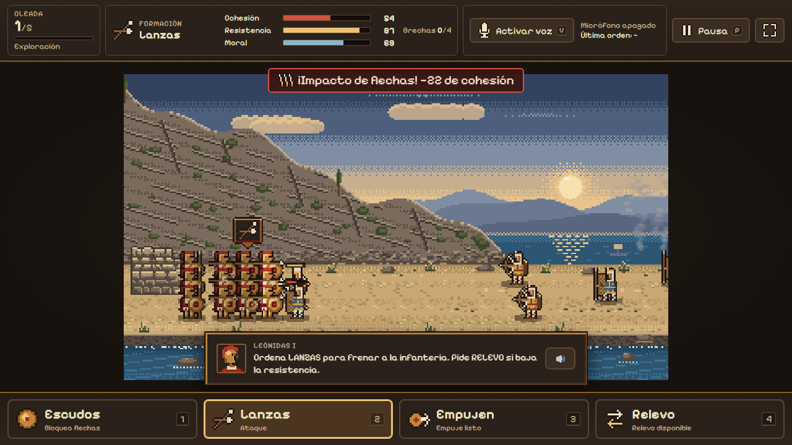</td>
    <td width="50%">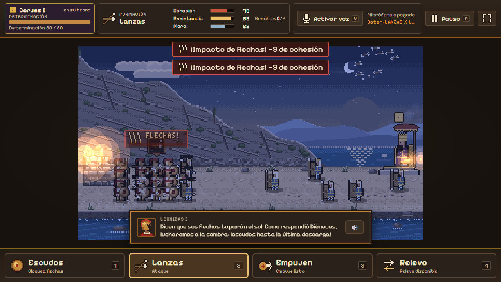</td>
  </tr>
  <tr>
    <td><b>Campaña.</b> Cinco oleadas de infantería, arqueros y guardia real. Las barras de cohesión, resistencia y moral te dicen cuándo cambiar de formación.</td>
    <td><b>Jerjes I.</b> El jefe final dirige el asalto desde su trono con decretos: tormentas de flechas, látigos que enfurecen a sus tropas y cargas de la guardia real.</td>
  </tr>
  <tr>
    <td>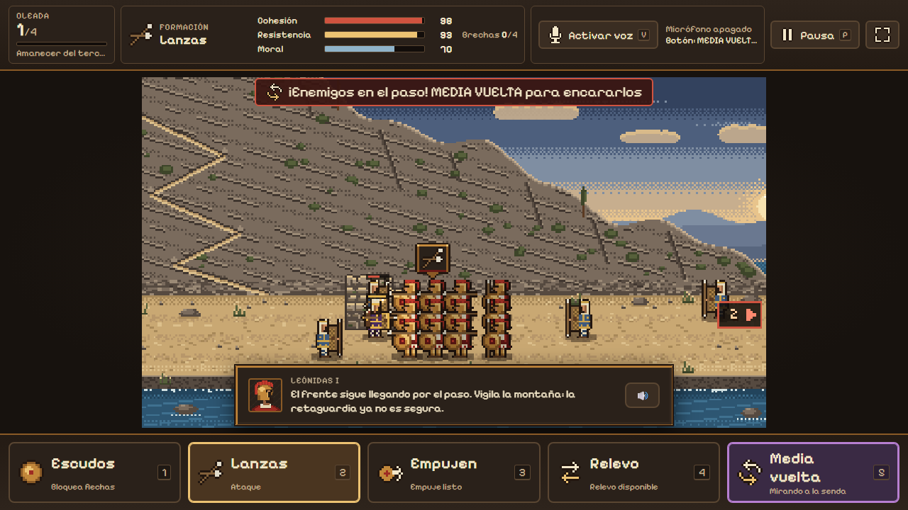</td>
    <td>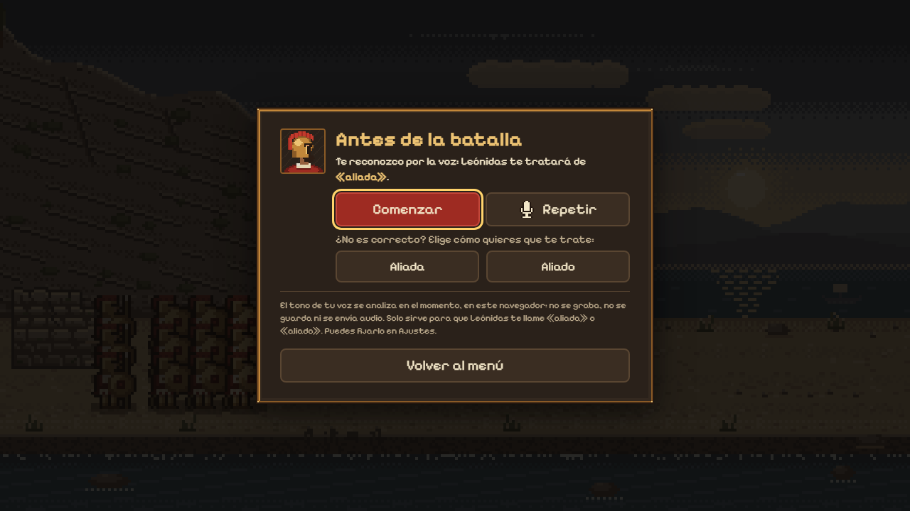</td>
  </tr>
  <tr>
    <td><b>La senda de Anopea.</b> Efialtes guía a los persas por la montaña y te atacan por los dos lados. Ordena «media vuelta» y la cámara gira con la falange.</td>
    <td><b>Antes de la batalla.</b> Leónidas escucha tu voz y decide cómo dirigirse a ti: «aliada», «aliado» o «estratega». Puedes corregirlo o saltarlo.</td>
  </tr>
</table>

<p align="center">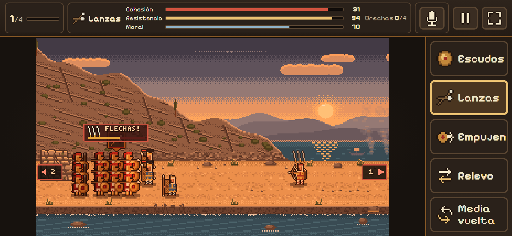</p>
<p align="center"><i>En el móvil, las órdenes pasan a una columna a la derecha y el campo de batalla ocupa casi toda la pantalla.</i></p>

### Más capturas

<table>
  <tr>
    <td width="50%">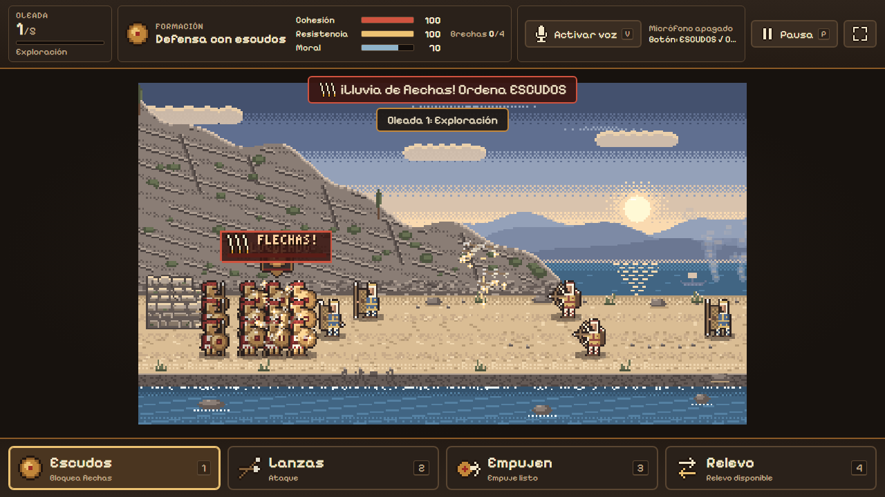</td>
    <td width="50%">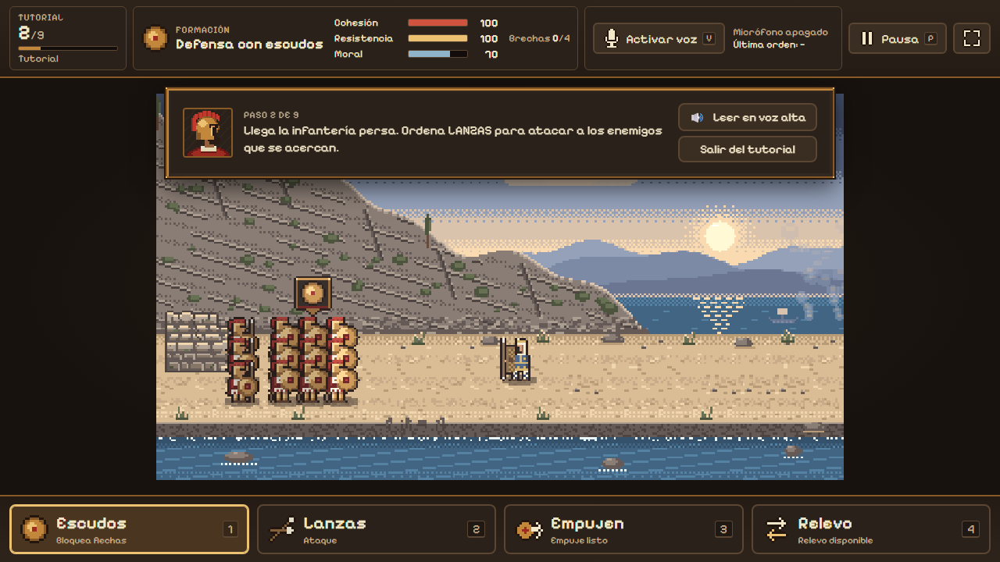</td>
  </tr>
  <tr>
    <td><b>Escudos arriba.</b> Cada lluvia de flechas se anuncia con una cuenta atrás. Con los escudos alzados, las flechas rebotan sin hacer daño.</td>
    <td><b>Tutorial.</b> Nueve pasos guiados por Leónidas, uno para cada orden, que no se pueden perder. Las indicaciones aparecen como texto en pantalla.</td>
  </tr>
  <tr>
    <td>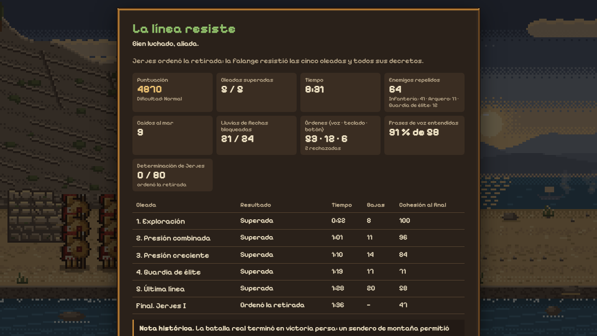</td>
    <td>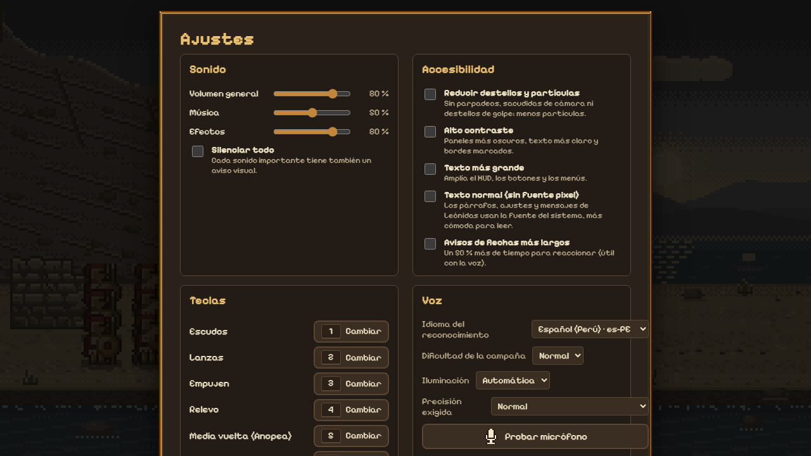</td>
  </tr>
  <tr>
    <td><b>Resultado.</b> Puntuación, tiempo, enemigos repelidos, flechas bloqueadas, órdenes por voz, teclado o botón, y una tabla con cada oleada.</td>
    <td><b>Ajustes.</b> Sonido, accesibilidad (alto contraste, texto grande, menos destellos), teclas reasignables, voz, dificultad e iluminación.</td>
  </tr>
</table>

<p align="center">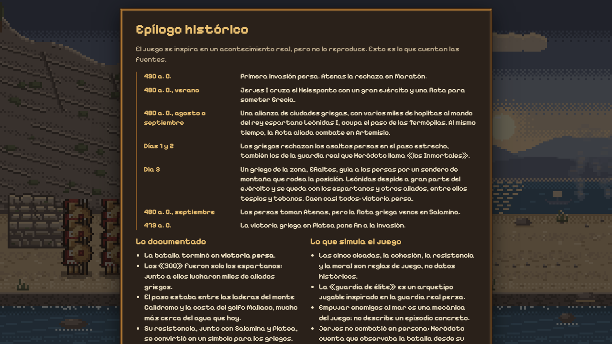</p>
<p align="center"><i>El epílogo histórico separa lo que cuentan las fuentes de lo que inventa el juego.</i></p>

## Características

- **Órdenes por voz, teclado o botones.** Se juega entero de cualquiera de las tres formas, y se pueden mezclar.
- **Campaña con jefe final.** Cinco oleadas de dificultad creciente y un enfrentamiento con Jerjes I en dos fases, con decretos que exigen respuestas distintas.
- **Escenario histórico «La senda de Anopea».** Dos frentes, la orden «media vuelta» y un escenario más amplio con el sendero bajando por el monte Calídromo.
- **Tres niveles de dificultad.** En Fácil, en la senda de Anopea te atacan por un solo lado cada vez y la falange gira sola, pensado para jugar con la voz.
- **Leónidas como comandante.** Parte de batalla, órdenes en cada oleada, y avisos cuando la línea flaquea, siempre por escrito en su panel.
- **Luz que cambia con la batalla.** Amanecer, mediodía, atardecer y noche, con estrellas, luna y antorchas en el muro de los focenses.
- **Pixel art y música originales.** Escenario por capas, animaciones de combate, logotipo propio y música sintetizada que crece con la intensidad.
- **Móvil y tableta.** Diseño táctil en horizontal y en vertical, pantalla completa y vibración.
- **Accesible.** Alto contraste, texto más grande o con fuente normal, menos destellos, avisos más largos y menús manejables con teclado.
- **Historia con rigor.** Un epílogo explica qué ocurrió de verdad (la batalla terminó en victoria persa) y qué es invención del juego.

## Cómo se juega

| Orden | Di… | Tecla | Para qué sirve |
|---|---|---|---|
| **Escudos** | «escudos», «falange» | 1 | Bloquea las lluvias de flechas. No ataca. |
| **Lanzas** | «lanzas», «ataquen» | 2 | Ataca al enemigo más adelantado de cada fila. Gasta resistencia. |
| **Empujen** | «empujen», «empujad» | 3 | Hace retroceder al enemigo: junto al acantilado cae al mar y la guardia real queda desequilibrada. |
| **Relevo** | «relevo», «cambio» | 4 | La reserva toma la primera línea y la falange recupera resistencia. |
| **Media vuelta** | «media vuelta», «retaguardia» | 5 | Solo en la senda de Anopea: encara el otro lado del paso. |
| Pausa / continuar | «pausa» / «continuar» | P o Esc | Detiene la partida. |
| Velocidad del tiempo | — | T | Acelera la batalla a ×2 o ×4 (y vuelve a ×1) para no esperar entre oleadas. También con el botón » de la barra superior. |
| Micrófono / sonido | — | V / M | Activa o silencia. |

Las teclas se pueden cambiar en **Ajustes**.

**Lo que tienes que vigilar:**

- **Cohesión.** Es la vida de la línea: si llega a cero, la falange cede.
- **Resistencia.** La gastan las lanzas y el empuje. Agotada, la formación solo acepta escudos y relevo.
- **Moral.** Con la moral alta, las lanzas hacen más daño.
- **Brechas.** Un enemigo que pasa demasiado tiempo trabado en la línea la atraviesa. Con cuatro brechas, pierdes.
- **Flechas.** Cada lluvia se anuncia con una cuenta atrás sobre los arqueros y sobre la falange.

## Voz y privacidad

- El reconocimiento de voz lo hace el propio navegador (Web Speech API). El juego solo compara lo que entiende con una lista cerrada de órdenes y nunca ejecuta una frase ambigua.
- Para saber cómo dirigirse a ti, antes de la batalla dices **cualquier palabra** y el juego estima el **tono** de tu voz en el momento, con Web Audio. **No se graba, no se guarda ni se envía audio**, y el resultado tampoco se guarda. Si prefieres que no se analice, fija el trato en **Ajustes**.
- El micrófono solo se pide cuando tú lo activas, y el juego no tiene servidor propio.
- Sin micrófono o sin permiso, todo sigue funcionando con el teclado y los botones.

## Ejecutar en local

Necesitas [Node.js](https://nodejs.org/) 20.19 o superior.

```bash
git clone https://github.com/C4R127/termopilas-game.git
cd termopilas-game
npm install
npm run dev
```

Abre http://localhost:5195/termopilas-game/ en el navegador. Para generar la versión de producción, usa `npm run build` (sale en `dist/`). `npm run deploy` la publica en GitHub Pages.

> **En Windows PowerShell**, si aparece «la ejecución de scripts está deshabilitada», usa `npm.cmd` en lugar de `npm` (por ejemplo, `npm.cmd run dev`).

## Tecnología

HTML5, CSS3 y JavaScript (ES Modules) con [Phaser 3.90](https://phaser.io/) y [Vite](https://vite.dev/). El lienzo trabaja a 320 × 180 píxeles y se amplía sin suavizado. El HUD y los menús son HTML accesible.

<details>
<summary><b>Estructura del código</b></summary>

```
src/
├─ main.js         entrada: Phaser, teclado, botones y escalado del lienzo
├─ app.js          composición: estado, eventos, ajustes, voz, audio, pantallas
├─ config/         valores de diseño (balance.js), Phaser (gameConfig.js) y luces (lighting.js)
├─ scenes/         menú, tutorial, batalla, senda de Anopea, HUD, resultado, fondo e iluminación
├─ entities/       la falange (reglas y dibujo), los enemigos y Jerjes
├─ systems/        simulación de la batalla, órdenes, oleadas, Jerjes, voz, tono, narración, audio
├─ data/           órdenes, oleadas, escenario de Anopea, Jerjes y mensajes de Leónidas
├─ ui/             HUD, pantallas, tutorial y panel de Leónidas
└─ styles/         estilos
public/assets/     pixel art, mapa del paso y fuente pixel
media/             capturas de este README
```

</details>

<details>
<summary><b>Decisiones técnicas</b></summary>

- **Reglas separadas del dibujo.** La simulación de la batalla avanza a paso fijo (1/60 s) y es determinista: da el mismo resultado con cualquier tasa de fotogramas y se puede jugar entera sin gráficos para equilibrar las oleadas. Las escenas de Phaser solo la dibujan.
- **Phaser donde aporta.** Escenas, animaciones, tweens, partículas y Arcade Physics para las flechas en parábola y los enemigos que caen al mar.
- **Dos frentes con las mismas reglas.** Los enemigos de la retaguardia usan una coordenada reflejada, así el movimiento, el contacto, las lanzas y el empuje funcionan igual a los dos lados.
- **Iluminación.** Una matriz de color sobre la cámara da cada momento del día. El fuego se dibuja en una segunda cámara sin corrección, para que la noche no lo vuelva azul.
- **Tono de voz.** Autocorrelación sobre fragmentos de 50 ms y la mediana de lo oído. Por debajo de 155 Hz, «aliado»; por encima de 175 Hz, «aliada»; entre medias, «estratega». El tono no siempre coincide con cómo se identifica cada persona, y por eso existen la franja neutra y la corrección manual.
- **Ajustes** guardados en el navegador, con teclas reasignables, y un diseño táctil resuelto con CSS, sin una versión aparte.

</details>

## Historia y créditos

Es una **interpretación lúdica** de un hecho real. La batalla terminó en victoria persa, y junto a los «300» espartanos lucharon miles de aliados griegos. Jerjes no combatió en persona y sus «decretos» son una mecánica de juego. La frase «lucharemos a la sombra» se atribuye al espartano Diéneces. El epílogo del juego lo cuenta con una línea temporal y fuentes (Heródoto, *Historias*, libro VII).

Todo el pixel art, los iconos, la fuente pixel y la música se crearon por código para este proyecto. No se usa material de la película *300*.
